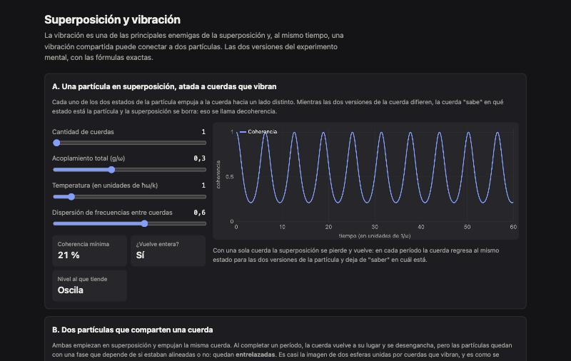

<div align="center">

# Strings and Coherence

**Superposición y vibración.** Cuánto dura una superposición atada a cuerdas que vibran, y cómo una vibración compartida entrelaza a dos partículas. Con fórmulas exactas.

[**▶ Probala en vivo**](https://loiaconobruno.github.io/strings-and-coherence/) · [**📄 Paper y guía**](https://loiaconobruno.github.io/strings-and-coherence/guia.html) · [Cómo funciona](#cómo-funciona) · [Limitaciones](#limitaciones)

[](https://github.com/LoiaconoBruno/strings-and-coherence/actions/workflows/tests.yml)


[](LICENSE)



</div>

Página interactiva que traduce el experimento mental "dos partículas en el mismo punto, unidas por cuerdas que vibran" a dos preguntas que la mecánica cuántica sí sabe responder, con fórmulas exactas:

- **A. Una partícula en superposición, atada a cuerdas que vibran:** ¿cuánto tarda la vibración en destruir la superposición?
- **B. Dos partículas que comparten una cuerda:** ¿esa vibración compartida puede entrelazarlas?

## Por qué

La intuición de la idea apunta a algo real: la vibración es una de las principales enemigas de la superposición (decoherencia) y, al mismo tiempo, una vibración compartida conecta partículas (así se entrelazan los iones en algunas computadoras cuánticas). La página muestra las dos cosas y una sorpresa: **una sola cuerda no destruye la superposición para siempre**; la decoherencia aparece cuando hay muchas.

## Instalación

No hace falta instalar nada: **[abrila en el navegador](https://loiaconobruno.github.io/strings-and-coherence/)**.

Para usarla sin conexión o modificarla:

```bash
git clone https://github.com/LoiaconoBruno/strings-and-coherence.git
```

Después abrí `index.html` con doble clic. No hay dependencias ni paso de build. Para correr los tests hace falta Node 18 o más nuevo:

```bash
npm test
```

## Uso

Abrí la [demo en vivo](https://loiaconobruno.github.io/strings-and-coherence/) o `index.html` con doble clic. Todo se recalcula al mover un deslizador.

Ejemplo:

1. **Versión A** con 1 cuerda, g/ω = 0,3 y temperatura 1: la coherencia baja hasta el **21 %** y **vuelve entera** en cada período (¿Vuelve entera? **Sí**).
2. Subí la **cantidad de cuerdas** a 50: la coherencia mínima es **18 %**, ya **no vuelve**, y tiende a un nivel de **39 %**.
3. Subí la **temperatura** a 5: la coherencia cae a **0 %** y el nivel al que tiende es **1 %**. Más calor, más decoherencia.
4. **Versión B** con g/ω = 0,25 y 1 período: el entrelazamiento al terminar es **100 %**. El gráfico de la derecha muestra que durante la compuerta las partículas se enredan con la cuerda, pero al final se desenganchan del todo, a cualquier temperatura.
5. Poné **2 períodos**: con el mismo acoplamiento el entrelazamiento vuelve a **0 %**, y el valor óptimo pasa a g/ω = **0,177**. Movelo a 0,177 y vuelve a **100 %**.

## Cómo funciona

Unidades con ħ = k = 1; la frecuencia típica de las cuerdas es ω = 1.

**A.** La partícula (dos estados, σz = ±1) se acopla a n modos de vibración con `H = Σ ωₖ aₖ†aₖ + σz Σ gₖ (aₖ + aₖ†)`, con las cuerdas en equilibrio térmico a temperatura T. La coherencia de la superposición tiene solución exacta:

```
|ρ₀₁(t)| / |ρ₀₁(0)| = Π exp(−4 (gₖ/ωₖ)² (1 − cos ωₖt) · coth(ωₖ / 2T))
```

Con una cuerda vuelve a 1 cada período `2π/ω`. Con muchas cuerdas de frecuencias distintas las vueltas se desfasan y la coherencia tiende a la meseta `exp(−Σ 4 (gₖ/ωₖ)² coth(ωₖ/2T))`. El acoplamiento se reparte entre las cuerdas (`gₖ = g/√n`) para comparar a igual fuerza total.

**B.** Dos partículas con `H = ω a†a + g (σz₁ + σz₂)(a + a†)`. Después de n períodos completos la cuerda se desengancha y las ramas alineadas (↑↑, ↓↓) acumulan una fase `4·2πn·(g/ω)²` respecto de las opuestas. Partiendo de ambas en superposición, la concurrencia es `|sen(8πn·(g/ω)²)|`: vale 1 con `g/ω = 1/(4√n)`.

La lógica está en `src/cuantica.js`, sin DOM, y se testea con:

```bash
npm test
```

## Limitaciones

- Es un modelo idealizado: acoplamiento lineal, cuerdas armónicas, sin pérdidas de energía. Las partículas no son esferitas ni las cuerdas, cuerdas: la imagen sirve como intuición, no como modelo.
- La meseta de la versión A es exacta solo para tiempos largos frente al desfase y cortos frente a la recurrencia de las cuerdas.
- La compuerta de la versión B está idealizada: en los experimentos reales las fases dependen de cómo se aplican los láseres.
- No simula "dos partículas en el mismo punto"; la página explica por qué esa es otra pregunta (Pauli, bosones).

## Próximos pasos

- Agregar pérdida de energía de la cuerda (amortiguamiento) para ver cuándo la compuerta deja de ser perfecta.
- Llevar la pregunta reformulada (versión A o B) a un profesor de física o a Physics Stack Exchange.
- Simularlo en QuTiP para comparar con la fórmula exacta.

## Paper de uso y guía

[`guia.html`](https://loiaconobruno.github.io/strings-and-coherence/guia.html) (fuente en [`docs/guia.md`](docs/guia.md)) tiene un paper de uso paso a paso y una guía de unas 20 páginas sobre la idea de fondo, con citas a los especialistas del tema.

## Licencia

MIT
